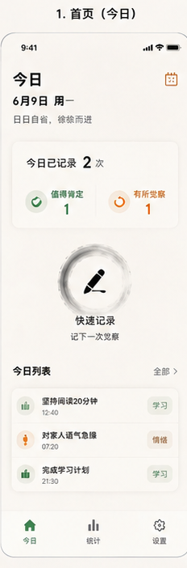
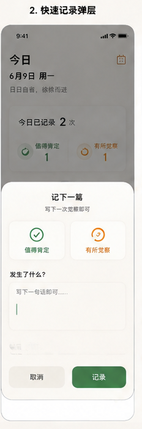
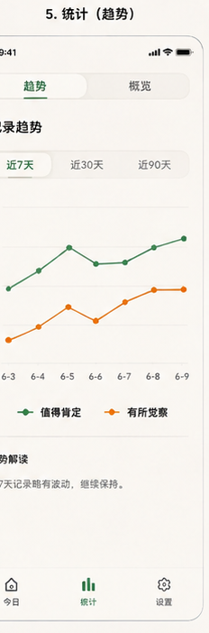
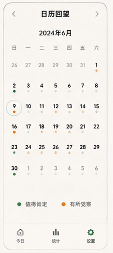
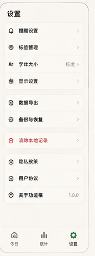
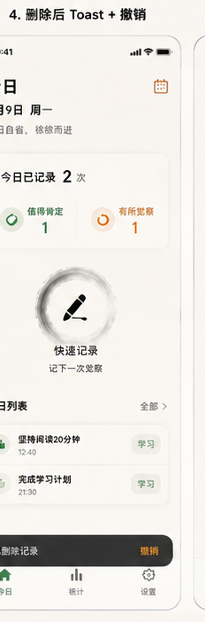

# 功过格 · Gongguoge

<p align="center">
  
</p>

<p align="center">
  <b>基于传统「功过格」理念的每日行为复盘工具</b><br />
  只做客观记录与趋势呈现 —— 不做连续打卡、不做分数抵消、不制造失败感
</p>

<p align="center">
  
  
  
  
  
  
</p>

一款「非评判性」的自我觉察 App：把每天的 **值得肯定** 与 **有所觉察** 分开记录，
用趋势代替评价，避免打卡类产品带来的焦虑内耗。

前后端完整可跑：Spring Boot 3 单体后端 + uni-app 跨端前端，含离线优先同步、真实短信验证码、数据导出与回收站。

---

## 界面预览

| 今日概览 | 快速记录 | 统计趋势 | 日历回望 | 设置 |
| :---: | :---: | :---: | :---: | :---: |
|  |  |  |  |  |

<p align="center">
  
  &nbsp;&nbsp;&nbsp;
  
</p>

---

## 项目亮点

| 亮点 | 说明 |
| --- | --- |
| **离线优先同步** | 断网也能记录：操作先入本地队列并标记「待同步」，联网后自动补传；服务端按 `clientId` 幂等去重，重复提交不会写重 |
| **非评判性设计** | 功、过独立计数，不做分数抵消；无连续打卡、无社交排名 |
| **隐私优先** | 手机号日志脱敏、导出手机号自动打码、上传文件不入库、`JWT_SECRET` 无默认值（缺失即拒绝启动） |
| **验证码安全** | `SecureRandom` 生成、一次性消费、场景隔离、**连续输错 5 次作废**、手机号 + **IP 双重限流** |
| **可验证** | 后端单测 36 + 接口 e2e 30 + 离线同步 20 + 云端同步集成 21 + 前端单测 51，共 **158 个自动化用例** |
| **一键部署** | 附 `deploy/` 部署包：CentOS 7 环境脚本、systemd 服务、Nginx 配置、完整部署手册 |

---

## 目录

- [界面预览](#界面预览)
- [项目亮点](#项目亮点)
- [功能特性](#功能特性)
- [技术栈](#技术栈)
- [目录结构](#目录结构)
- [快速开始](#快速开始)
- [配置说明](#配置说明)
- [安全说明](#安全说明)
- [接口一览](#接口一览)
- [数据库设计](#数据库设计)
- [设计规范](#设计规范)
- [开发说明](#开发说明)
- [接口测试](#接口测试)
- [自动化测试总览](#自动化测试总览)
- [部署上线](#部署上线)
- [许可证](#许可证)

---

## 功能特性

| 模块 | 能力 |
| --- | --- |
| 用户体系 | **双通道账号**：① 手机号注册 / 登录（短信验证码或密码）；② **用户名 + 密码**注册 / 登录（无需手机号，适合软件著作权 / App 备案提交测试账号）。含修改密码、退出登录，JWT 无状态鉴权，已登录冷启动免登录 |
| 功过记录 | 新增 / 编辑 / 删除记录，选择分类、添加描述，支持补填过往日期 |
| 分类管理 | 预设「自律 / 学习 / 健康 / 人际 / 习惯」功过两套分类，支持自定义增删 |
| 今日概览 | 当日功 / 过数量与记录列表，删除后 5 秒内可撤销 |
| 日历回望 | 月历视图标记有记录的日期，点击查看当日明细 |
| 数据统计 | 近 7 / 30 / 90 天趋势折线图、本月分类占比（功过分开展示，不做抵消） |
| 回收站 | 删除记录进入回收站，支持恢复或彻底删除 |
| 数据管理 | 一键导出 JSON / CSV（自动解析分类名、手机号打码），一键清空个人数据 |
| 意见反馈 | 应用内提交问题与建议 |
| 显示设置 | 浅色 / 深色 / 跟随系统，三档字体大小 |
| 每日提醒 | 可配置提醒时间；**仅在打包为 App 后生效**（见下方说明） |
| 隐私合规 | 首次启动强制展示协议与隐私政策，明示同意后方可使用；设置页支持撤回同意 |
| 离线优先 | 断网时记录先落本地并在列表标注「待同步」，恢复网络后自动补传，不丢数据 |


### 关于离线优先同步

实现方式（策划书 §2.2「网络异常时本地缓存，恢复网络后自动同步」）：

- **写操作先入本地队列再直传**：入队保证离线不丢，直传成功立即摘除。队列存在 `uni` 本地存储，App 被杀也不丢。
- **操作粒度而非请求粒度**：队列记录用户意图（`create` / `update` / `delete` / `purge`），同一笔记录用同一个 `clientId`，因此「离线新增→离线修改→离线删除」能按顺序正确重放。
- **幂等去重**：服务端按 `(userId, clientId)` 去重，客户端可在任意时刻重复提交整个队列而不会产生重复数据。
- **待同步可见**：本地镜像记录在首页即时可见并标注「待同步」，同步成功后转为服务端记录。
- **触发时机**：App 启动、`onNetworkStatusChange` 网络恢复、进入首页。
- **合规优先**：未同意隐私协议前不发起任何同步。

队列合并规则（避免重复提交与无效操作）：同一 `clientId` 的重复 `create` 只保留一条；多次 `update` 只保留最新；`delete` / `purge` 会清除该记录尚未提交的 `update`。


### 关于隐私同意流程

按上架合规要求实现，不是「静默视为同意」：

- **首次启动**：鉴权页常驻同意弹窗，必须勾选后点击「同意并继续」才能操作；点「不同意」在 App 端直接退出应用，H5 / 小程序端保持弹窗并明确提示。
- **纵深防御**：即使通过其他路径进入，`sendCode` / `submit` 也会再次校验同意状态；`App.vue` 在 `onLaunch` 做一致的重定向兜底。
- **版本化**：协议内容实质变更时递增 `PRIVACY_VERSION`（`frontend/utils/privacy.js`），已同意旧版本的用户会被再次要求确认。
- **可撤回**：设置 → 用户协议与隐私政策 → 撤回协议同意，撤回后重新展示同意弹窗。


### 关于「每日提醒」的诚实说明

uni-app 没有跨端的「后台定时推送」API。当前实现为：

- **App 端（Android/iOS）**：使用系统本地通知 `plus.push.createMessage`。该 API 只能**立即**创建通知，无法预约未来时刻，因此采用「启动补齐」策略 —— 冷启动或回到前台时，若当天提醒时刻已过且尚未提醒，则补发一条。
- **H5 / 小程序**：无本地通知能力，页面会**明确提示不支持**，不会伪造「已开启」状态。

若需要 App 完全退出后仍严格准时推送，需接入原生定时任务（Android AlarmManager / WorkManager）或服务端推送（uni-push 等），超出纯前端范围。

---

## 技术栈

**后端**

| 技术 | 版本 | 说明 |
| --- | --- | --- |
| JDK | 17 | Spring Boot 3.x 要求 |
| Spring Boot | 3.3.3 | 核心框架 |
| MyBatis-Plus | 3.x | 数据访问，`BaseMapper` + 注解 SQL |
| MySQL | 8.0 | 关系型数据库 |
| Redis | 5.0+ | 登录态与短信验证码存储、发送频率限制 |
| JWT | jjwt | 无状态鉴权 |
| springdoc-openapi | - | Swagger UI |
| Lombok | - | 简化实体类 |

**前端**

| 技术 | 说明 |
| --- | --- |
| uni-app（Vue 2） | 一套代码多端编译，可打包安卓 APK |
| 自研 CSS 设计令牌 | 深浅色主题统一由 CSS 变量驱动，无第三方 UI 库依赖 |
| 自研 SVG 图表 | 趋势折线图与环形图，无 uCharts 依赖 |

> 说明：页面组件、图标组件（`GIcon`）、主题容器（`ThemePage`）、请求封装均为项目自研，未引入 uView / uCharts。

---

## 目录结构

```
goodBadProject/
├── backend/                     # Spring Boot 后端
│   ├── src/main/java/com/gongguoge/
│   │   ├── controller/          # 控制层（8 个）
│   │   ├── service/             # 业务层（8 个）
│   │   ├── mapper/              # 数据访问层（MyBatis-Plus）
│   │   ├── pojo/                # 实体类
│   │   ├── dto/ vo/             # 传输对象
│   │   ├── config/              # 配置类
│   │   └── common/              # 统一响应、异常、工具
│   ├── src/main/resources/
│   │   ├── application.yml          # 主配置（敏感项走环境变量）
│   │   └── application-local.yml    # 本机配置（已 gitignore，含本地数据库密码）
│   └── .env.example             # 后端环境变量模板
├── frontend/                    # uni-app 前端
│   ├── pages/                   # 18 个页面
│   ├── components/              # GIcon / PageNav / ThemePage / PrivacyConsent
│   ├── utils/                   # api / request / store / appearance / reminder / privacy / platform / permission / offline / sync
│   ├── scripts/                 # unit-test.mjs（前端单元测试）
│   ├── static/
│   ├── pages.json
│   └── App.vue                  # 全局样式与设计令牌定义
├── backend/
│   ├── src/test/                # 单元测试（JwtUtilTest / PasswordEncoderTest / AuthServiceSmsTest）
│   └── scripts/                 # e2e-test.mjs / sync-test.mjs / clean-test-data.mjs
├── database/init/01_schema.sql  # 建表与预设分类
├── docker-compose.yml           # MySQL + Redis + MinIO（MinIO 为预留）
├── .env.example                 # Compose 环境变量模板
└── 功过格・项目策划书.md          # 产品策划书
```

---

## 快速开始

### 方式一：Docker Compose（推荐）

```bash
cp .env.example .env      # 按需修改端口与密码
docker compose up -d      # 启动 MySQL / Redis / MinIO
```

MySQL 首次启动会自动执行 `database/init/01_schema.sql` 完成建表与预设分类。

### 方式二：本地已有 MySQL / Redis

> **最省事的做法（推荐）**：项目自带 `backend/src/main/resources/application-local.yml`，
> 里面已经写好本机数据库密码（`root` / `1234`）并关闭了短信。
> 在 IDEA 里把 **Active profiles** 设为 `local` 就能直接运行，不用配任何环境变量。
> 该文件已被 `.gitignore` 忽略，密码不会进仓库。
>
> 改成你自己的密码：编辑 `application-local.yml` 里的 `spring.datasource.password`。

1. 执行建表脚本：

```bash
mysql -uroot -p < database/init/01_schema.sql
```

2. 启动后端（默认端口 8080）：

```bash
# 用 local profile（读取 application-local.yml）
cd backend
mvn spring-boot:run -Dspring-boot.run.profiles=local
```

或通过环境变量注入（不使用 local profile 时）：

```powershell
$env:MYSQL_PASSWORD="你的密码"; $env:ALIYUN_SMS_ENABLED="false"; mvn spring-boot:run
```

> 为什么密码不直接写进 `application.yml`：该文件会提交进仓库，硬编码密码一旦入库就是泄漏。
> 因此 `application.yml` 里是 `${MYSQL_PASSWORD:...}` 占位，本机真实密码放在被忽略的 `application-local.yml`。

3. 启动前端：用 **HBuilderX** 打开 `frontend/` 目录，运行到浏览器或手机模拟器；打包 APK 使用「发行 → 原生 App 云打包」。

### 前置依赖

| 依赖 | 是否必需 | 说明 |
| --- | --- | --- |
| JDK 17 | 必需 | 后端编译运行 |
| Maven 3.8+ | 必需 | 后端构建 |
| MySQL 8 | 必需 | 数据存储 |
| **Redis** | **必需** | 登录态与短信验证码依赖它，未启动时注册/登录会失败 |
| HBuilderX | 前端需要 | uni-app 运行与打包 |
| MinIO | 可选 | 后端代码尚未接入，仅 Compose 中预留 |

---

## 配置说明

后端配置全部支持环境变量覆盖（见 `backend/src/main/resources/application.yml`）：

| 变量 | 默认值 | 说明 |
| --- | --- | --- |
| `MYSQL_HOST` | `localhost` | 数据库地址 |
| `MYSQL_PORT` | `3306` | 数据库端口 |
| `MYSQL_DATABASE` | `gongguoge` | 数据库名 |
| `MYSQL_USER` | `root` | 数据库用户 |
| `MYSQL_PASSWORD` | 空 | 数据库密码（本地请自行注入） |
| `REDIS_HOST` / `REDIS_PORT` | `localhost` / `6379` | Redis 连接 |
| `REDIS_PASSWORD` | 空 | Redis 密码 |
| `JWT_SECRET` | **无默认值（必填）** | 签名密钥，至少 32 字节随机串；缺失会导致启动失败。生成：`openssl rand -base64 48` |
| `JWT_EXPIRATION` | `604800` | Token 有效期（秒，默认 7 天） |
| `ALIYUN_SMS_ENABLED` | `false` | `false` 时验证码取 `ALIYUN_SMS_MOCK_CODE`，不真实发送 |
| `ALIYUN_SMS_MOCK_CODE` | **无默认值（关闭短信时必填）** | 开发用固定验证码。**留空且短信未启用时后端会拒绝启动**，防止固定验证码被带到公网 |
| `ALIYUN_SMS_ACCESS_KEY_ID` | 空 | 阿里云短信 AccessKey ID |
| `ALIYUN_SMS_ACCESS_KEY_SECRET` | 空 | 阿里云短信 AccessKey Secret |
| `ALIYUN_SMS_SIGN_NAME` | 空 | 短信签名 |
| `ALIYUN_SMS_TEMPLATE_CODE` | 空 | 短信模板编号 |
| `UPLOAD_DIR` | `./uploads` | 头像等上传文件的本地存储目录 |
| `UPLOAD_MAX_SIZE` | `2MB` | 单文件大小上限 |

### 文件上传

- `POST /api/files/upload`（需登录）上传头像，返回相对地址 `/api/files/avatar/{yyyyMMdd}/{uuid}.{ext}`。
- `GET /api/files/avatar/{yyyyMMdd}/{filename}`（**免登录**）回传文件。
  免登录是必要的：`<image src>` 无法携带 `Authorization` 头。文件名是随机 UUID 不可枚举，且日期与文件名都做了正则校验与路径穿越防护。
- 仅接受 `jpg / jpeg / png / webp / gif`，单文件不超过 2MB。
- 存库保存的是**相对地址**，换域名或部署环境无需迁移数据。
- 上传目录通过 `UPLOAD_DIR` 配置，已加入 `.gitignore`。

> **本地开发默认不需要阿里云账号**：`ALIYUN_SMS_ENABLED=false` 时不会调用阿里云，验证码固定为 mock 值（见 `AuthService`），注册登录照常可用。

### 安全约定

- `.env`、密钥文件、构建产物均已在 `.gitignore` 中忽略；请勿将真实密钥提交进仓库。
- 密码使用 BCrypt 加密存储，数据库中不保存明文。
- 短信验证码存于 Redis，5 分钟过期，并做 1 分钟发送频率限制。

---

## 安全说明

部署到公网前请务必确认以下四点。

### 1. 短信验证码：默认配置下**不可**直接公网部署

登录使用「手机号 + 短信验证码」，且**未注册的手机号会自动注册**。因此验证码一旦可被预测，等于任意账号可被接管。

项目为此做了两道限制：

- **验证码不再硬编码**。短信未启用时使用 `ALIYUN_SMS_MOCK_CODE` 指定的固定验证码，该值**没有默认值**；
- **启动自检**。若 `ALIYUN_SMS_ENABLED=false` 且 `ALIYUN_SMS_MOCK_CODE` 为空，后端会**拒绝启动**并给出提示：

  ```
  短信服务未启用（aliyun.sms.enabled=false）且未配置 mock 验证码。
  生产环境请设置 ALIYUN_SMS_ENABLED=true 并填入真实密钥；
  开发环境请在 application-local.yml 配置 aliyun.sms.mock-code（例如 123456）。
  ```

所以：

| 环境 | 配置 |
| --- | --- |
| 本地开发 | `application-local.yml` 里设 `aliyun.sms.mock-code: "123456"`，验证码固定，方便调试 |
| 生产环境 | `ALIYUN_SMS_ENABLED=true` + 阿里云真实密钥，验证码由 `SecureRandom` 生成 |

> 另注：验证码用 `SecureRandom` 而非 `Random`（后者可被预测，不适合安全场景），
> 发送频率限制为同一手机号 1 分钟一次，验证码 5 分钟有效且**一次性消费**（用后即删，不可重放）。

#### 验证码已加固的四个方面

| 防护 | 做法 | 防的是 |
| --- | --- | --- |
| 不可预测 | `SecureRandom` 生成 6 位码 | 猜码 |
| 不可重放 | 校验通过后立即从 Redis 删除 | 抓包后重放 |
| 场景隔离 | Redis key 带 `scene`（login / register） | 注册码被拿去登录 |
| **防暴力枚举** | 同一验证码连续输错 **5 次即作废**，必须重新获取 | 在 5 分钟有效期内枚举 100 万种可能 |

### 2. JWT 密钥必须注入

`jwt.secret` **没有默认值**，缺失时后端起不来。生成方式：

```bash
openssl rand -base64 48
```

### 3. 日志不打印明文手机号

手机号属个人信息（《个人信息保护法》），所有涉及手机号的日志都经 `PhoneMask` 脱敏为 `138****1234`。

### 4. 用户上传文件不入库

头像等上传文件保存在 `backend/uploads/`，**已在 `.gitignore` 中排除**，不会被提交。

## 接口一览

统一响应格式为 `{ code, message, data }`，需要鉴权的接口通过 `Authorization: Bearer <token>` 传递。

### 认证 `/api/auth`

| 接口 | 控制器 |
| --- | --- |
| `/api/auth/sms-code` | AuthController |
| `/api/auth/register` | AuthController |
| `/api/auth/login` | AuthController |
| `/api/auth/logout` | AuthController |
| `PUT /api/auth/password` | AuthController |

### 用户 `/api/user`

| 接口 | 控制器 |
| --- | --- |
| `GET /api/user/profile` | UserController |
| `PUT /api/user/profile` | UserController |

### 分类 `/api/categories`

| 接口 | 控制器 |
| --- | --- |
| `GET /api/categories` | CategoryController |
| `POST /api/categories` | CategoryController |
| `DELETE /api/categories/{id}` | CategoryController |

### 记录 `/api/records`

| 接口 | 控制器 |
| --- | --- |
| `/api/records/today` | RecordController |
| `/api/records` | RecordController |
| `/api/records` | RecordController |
| `/api/records/{id}` | RecordController |
| `/api/records/{id}` | RecordController |
| `/api/records/recycle` | RecordController |
| `/api/records/recycle/{id}/restore` | RecordController |
| `/api/records/recycle/{id}` | RecordController |

### 统计 `/api/statistics`

| 接口 | 控制器 |
| --- | --- |
| `/api/statistics` | StatisticsController |
| `/api/statistics/overview` | StatisticsController |
| `/api/statistics/trend` | StatisticsController |
| `/api/statistics/category` | StatisticsController |

### 其他

| 接口 | 控制器 | 说明 |
| --- | --- | --- |
| `POST /api/files/upload` | FileController | 上传头像（需登录） |
| `GET /api/files/avatar/{date}/{name}` | FileController | 读取头像（免登录，供 image 标签使用） |
| `POST /api/sync/batch` | SyncController | 批量同步（幂等，用于离线补传） |
| `GET /api/feedback` | FeedbackController | 反馈列表 |
| `POST /api/feedback` | FeedbackController | 提交反馈 |
| `GET /api/data/export` | DataController | 导出全部数据 |
| `DELETE /api/data/clear` | DataController | 清空个人数据 |

启动后可访问 Swagger UI：`http://localhost:8080/swagger-ui.html`

---

## 数据库设计

命名规范：表名小写 + 下划线，统一 `t_` 前缀；每表含主键、创建/更新时间、逻辑删除标记。

| 表名 | 说明 | 字段数（近似） |
| --- | --- | --- |
| `t_user` | - | 11 |
| `t_category` | - | 10 |
| `t_merit_record` | - | 13 |
| `t_feedback` | - | 7 |
| `t_sms_log` | - | 8 |

预设分类（功 / 过各一套）：自律、学习、健康、人际、习惯。

---

## 设计规范

**风格**：中式简约水墨，素雅克制，留白充足，低视觉刺激。

**色彩**（定义于 `frontend/App.vue` 的 CSS 变量，深色模式仅覆盖变量值）：

| 用途 | 浅色 | 深色 |
| --- | --- | --- |
| 页面底色 | `#f8f5ee` | `#1d1e1b` |
| 卡片背景 | `rgba(255,255,255,0.75)` | `rgba(36,38,34,0.92)` |
| 正文 | `#292a27` | `#ece9e1` |
| 次要文字 | `#77756f` | `#aaa79e` |
| 功（肯定）主色 | `#367d57` | `#7cc39a` |
| 过（觉察）主色 | `#a45d36` | `#d99a76` |

**主题实现**：`ThemePage` 组件为每个页面根节点挂载 `theme-dark` / `theme-light` 与 `font-small` / `font-medium` / `font-large` 类名；配色统一走 CSS 变量，因此新增页面**自动**支持深色模式与字体缩放。

---

## 开发说明

- **前端页面结构**：每页使用 `<ThemePage>` 包裹，样式中的颜色一律引用 `var(--ggg-*)` 令牌，不要写死十六进制色值 —— 这是保证深色模式不漏白的前提。
- **接口调用**：统一通过 `utils/api.js` 暴露的模块调用，不要直接写 `uni.request`。`utils/request.js` 会自动附加 Token，并在 401 时清空登录态跳转登录页。
- **本地存疑数据**：`utils/store.js` 只负责日期工具与本地资料缓存；记录、分类、回收站、反馈全部走后端接口，不含任何本地假数据。
- **写操作请走离线队列**：新增/修改/删除记录应调用 `utils/sync.js` 的 `submitOperation()`，不要直接调 `recordApi.add/remove`。队列会保证离线不丢、联网自动补传，并复用同一个 `clientId` 实现幂等。直接调接口会让离线场景丢数据。
- **本地镜像**：`utils/offline.js` 的 `upsertLocalRecord()` 用于让离线新增的记录**立即出现在列表里**（`pending: true`）。同步成功后由 `markSynced()` 去掉标记。

### 已知事项 / 待办

- [ ] 每日小结（当天一句话总结）——策划书 V1.1 预留。
- [ ] 广告位：策划书要求 1.0 仅做布局占位，当前未插入。
- [ ] MinIO 对象存储尚未接入（头像上传目前仅存 URL）。
- [ ] 退出登录不吊销服务端 token：JWT 纯无状态，`logout` 仅返回成功，已签发 token 在有效期内仍可用（详见下方「认证语义」）。
- [x] 权限申请前的用途说明弹窗：通知权限与数据导出均先说明用途，并提供「权限管理」页查看与重置（策划书 §3.2 / §10.3）。
- [x] 离线优先同步：本地操作队列 + 断网自动补传 + 服务端按 `clientId` 幂等（详见「关于离线优先同步」）。
- [x] 首次启动强制同意协议与隐私政策（含版本化与撤回同意）。
- [x] 自动化测试：后端单元测试 21 个（JWT / 密码加密 / 认证安全）、接口测试 30 个、离线同步专项 16 个、前端单元测试 51 个。

### 认证语义

- 密码使用 BCrypt 加密后入库，数据库不保存明文。
- 短信验证码存于 Redis，5 分钟过期，同一手机号 1 分钟内限发一次，验证成功后立即删除（**不可重放**）。
- 验证码按 `scene` 隔离：`register` 场景的验证码不能用于 `login`。
- **登录态为纯 JWT**：服务端不保存会话。因此 `POST /api/auth/logout` 不吊销已签发的 token —— 客户端需自行删除本地 token；若需要「退出即失效」或「改密后踢下线」，需引入 Redis 黑名单或 token 版本号机制。

---

## 接口测试

位于 `backend/scripts/`，只依赖 Node 18+（内置 `fetch`），无需安装任何包。详见 [backend/scripts/README.md](backend/scripts/README.md)。

```bash
# 端到端接口测试：30 个用例，覆盖认证/鉴权/记录/统计/回收站/离线同步/幂等
node backend/scripts/e2e-test.mjs

# 离线同步专项：16 个用例，覆盖 create/update/delete/purge 与幂等
node backend/scripts/sync-test.mjs

# 清理测试数据（默认预览；只删除测试脚本显式标记的账号）
node backend/scripts/clean-test-data.mjs
```

前置条件：MySQL 与 Redis 已启动、后端已运行，并以 `ALIYUN_SMS_ENABLED=false` 启动（验证码固定为 `123456`）。

> **安全说明**：测试脚本注册账号时会显式使用昵称 `测试账号`，清理脚本只删除带此标记的数据和你用 `--phone` 显式指定的手机号。它**不会**根据手机号段猜测，因此你手工注册的账号不会被误删。请不要把自己账号的昵称改成「测试账号」。

## 自动化测试总览

| 层级 | 位置 | 用例数 | 依赖 |
| --- | --- | --- | --- |
| 后端单元测试 | `backend/src/test/` | 21 | 仅 JVM（无需 MySQL / Redis / 启动服务） |
| 后端接口测试 | `backend/scripts/e2e-test.mjs` | 30 | 需后端运行 + MySQL + Redis |
| 离线同步专项 | `backend/scripts/sync-test.mjs` | 16 | 需后端运行 + MySQL + Redis |
| 前端单元测试 | `frontend/scripts/unit-test.mjs` | 51 | 仅 Node |
| 前端静态校验 | `verify-frontend.mjs`（仓库外工具） | 7 类检查 | 仅 Node |

```bash
# 后端单元测试（最快，适合提交前跑）
mvn -o test

# 前端单元测试
node frontend/scripts/unit-test.mjs
```

**后端单元测试覆盖**：
- `JwtUtilTest`：token 生成与校验、过期拒绝、篡改拒绝、异密钥拒绝、畸形输入不抛异常
- `PasswordEncoderTest`：BCrypt 密文不含明文、密文格式、随机盐、正确/错误密码校验、大小写敏感
- `AuthServiceSmsTest`：验证码场景隔离、错误码拒绝、防重放（一次性消费）、1 分钟限流、未注册自动注册、昵称标记、禁用账号拒绝

**前端单元测试覆盖**（mock `uni` / `plus`，无需 HBuilderX）：
- 协议同意状态机（含版本升级后重新要求同意、撤回同意）
- 权限说明流程（用途文案、同意/拒绝分支、仅首次说明、重置）
- 平台能力判断（`isApp` / `isH5` / `canLocalNotify` / `quitApp`）
- 离线队列合并规则（重复 `create` 去重、`update` 覆盖、`delete` 清除待提交 `update`、精确与批量移除、本地镜像 `pending` 标记与清理）
- 日期与手机号掩码工具、本地资料缓存（确认不含任何假数据）

---

## 部署上线

完整的服务器部署步骤见 **[deploy/DEPLOY.md](deploy/DEPLOY.md)**，包含：

| 文件 | 用途 |
| --- | --- |
| [`deploy/DEPLOY.md`](deploy/DEPLOY.md) | 部署手册：从阿里云控制台配置到 App 打包，命令可直接复制 |
| [`deploy/setup-server.sh`](deploy/setup-server.sh) | 一键装好 JDK 17 / MySQL 8 / Redis（**已处理 CentOS 7 EOL 换源**、MariaDB 残留数据目录等坑） |
| [`deploy/gongguoge.service`](deploy/gongguoge.service) | systemd 服务（用 `EnvironmentFile` 读密钥，**密钥不进仓库**） |
| [`deploy/app.env.example`](deploy/app.env.example) | 服务器环境变量模板 |
| [`deploy/nginx-gongguoge.conf`](deploy/nginx-gongguoge.conf) | Nginx 反向代理（HTTP / HTTPS 两套） |

### 部署前必须注意的三点

1. **`JWT_SECRET` 无默认值** —— 不设置后端会拒绝启动（故意的，避免用公开弱密钥上线）。生成：`openssl rand -base64 48`
2. **短信验证码** —— `ALIYUN_SMS_ENABLED=false` 时验证码取 `ALIYUN_SMS_MOCK_CODE`（仅开发用）；**正式上线必须开启真实短信**，否则用户拿不到验证码、无法登录
3. **`frontend/utils/config.js`** —— 打包前把 `PROD_HOST` 改成你的域名或公网 IP

---

## 许可证

本项目采用 **MIT OR Apache-2.0 双许可**，你可以任选其一：

- [MIT License](LICENSE-MIT)
- [Apache License 2.0](LICENSE-APACHE)

即：使用、修改、分发、商用均可，保留版权声明即可；选择 Apache-2.0 时还额外获得贡献者的专利授权。

> Apache-2.0 与 MIT 的差别主要在**专利条款**：前者明确授予专利许可。双许可是 Rust 等项目的常见做法，
> 让使用者按自己项目的许可证兼容性自由选择。

